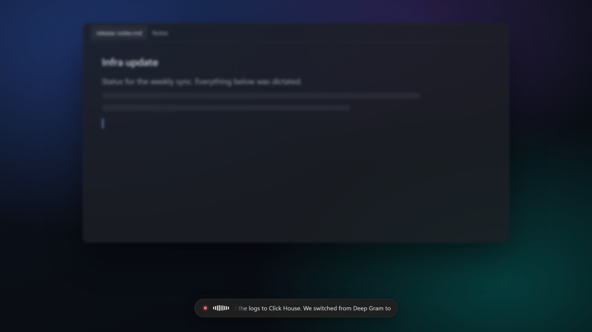
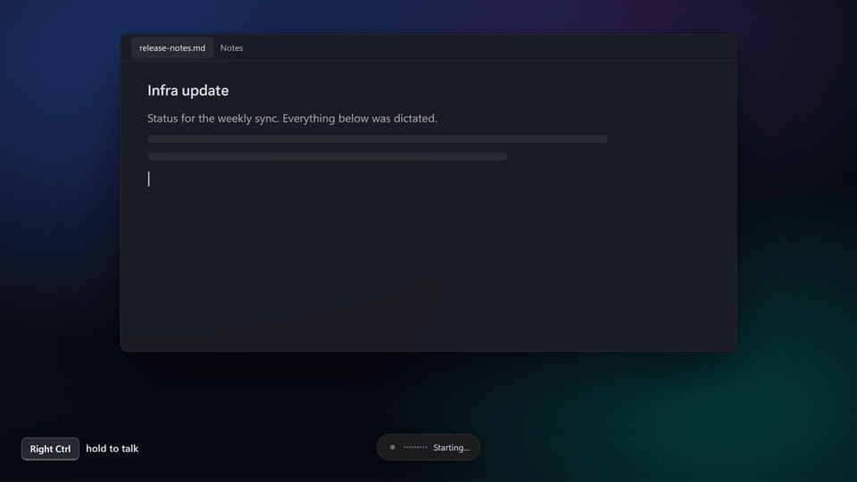
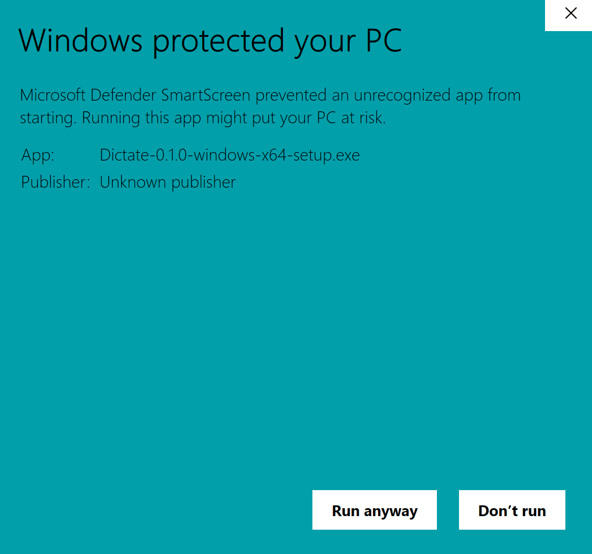
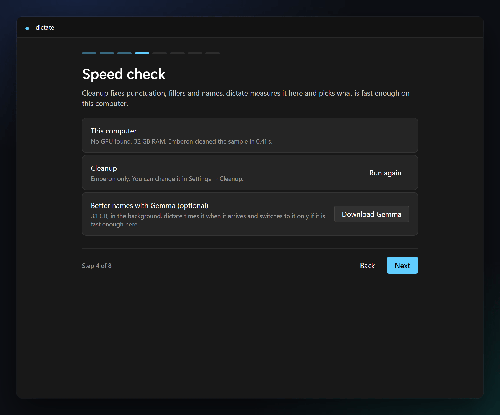
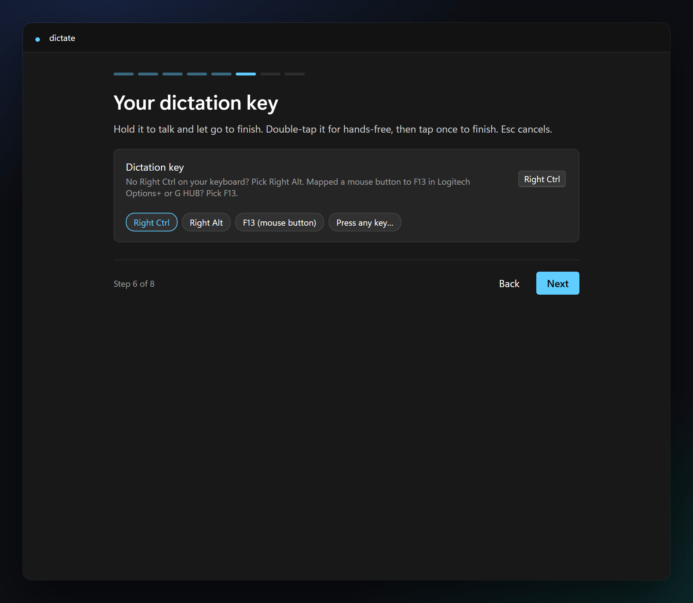
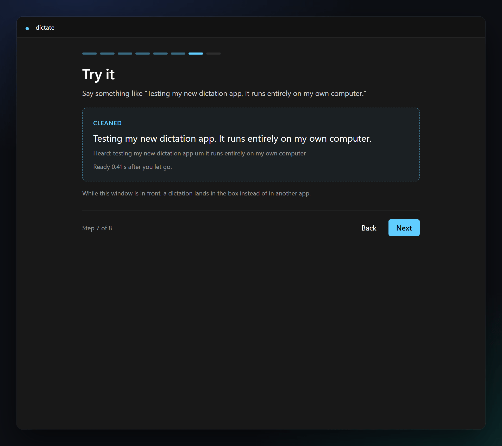
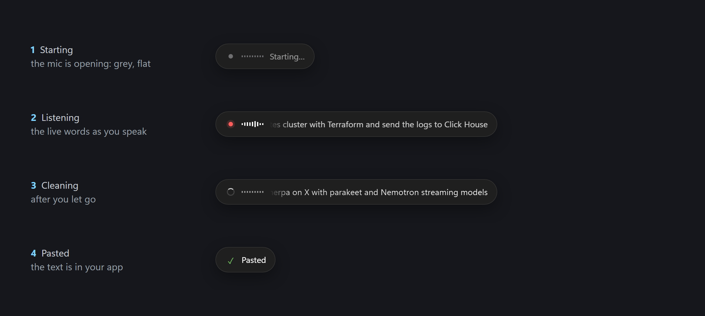
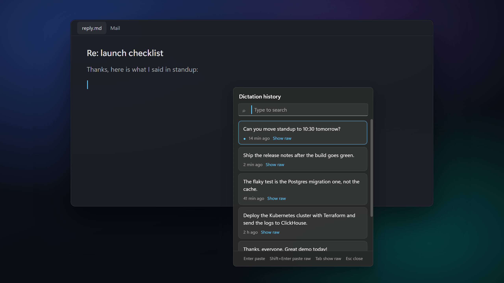
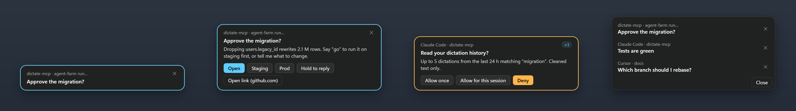
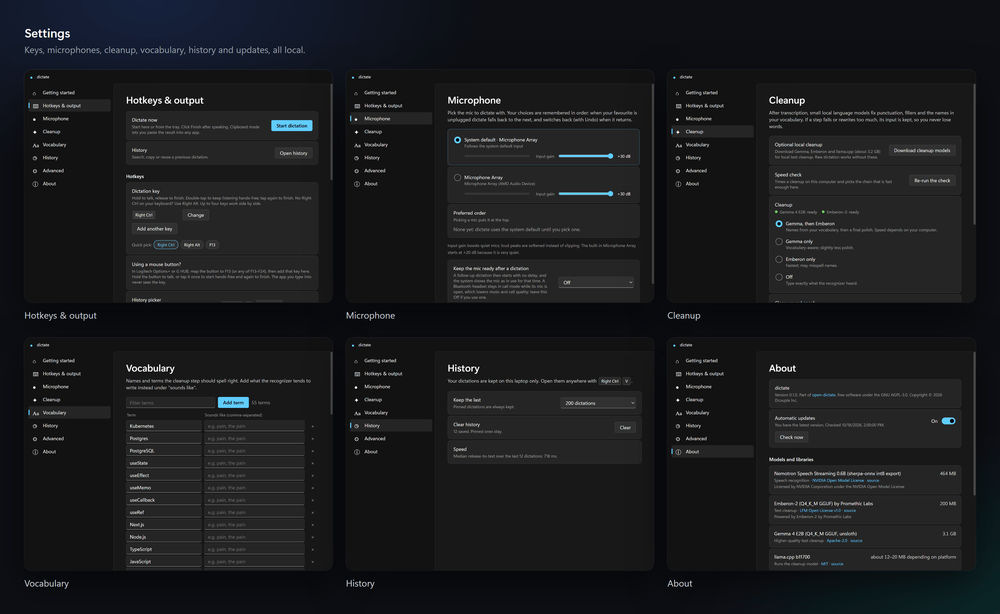

<p align="center">
  
</p>

<h1 align="center">open-dictate</h1>

<p align="center">
  <strong>Hold a key, speak, and clean text appears wherever you type. Fully local.</strong><br>
  <em>An open-source Willow Voice / Superwhisper alternative for Windows, macOS and Linux.</em>
</p>

<div align="center">

[](./LICENSE)
[](https://github.com/parsakhaz/open-dictate/releases/latest)
[](https://github.com/parsakhaz/open-dictate/actions/workflows/ci.yml)
[](#install)
[](#privacy)

<br>

<a href="https://github.com/parsakhaz/open-dictate/releases/latest"></a>
<a href="https://github.com/parsakhaz/open-dictate/releases/latest"></a>
<a href="https://github.com/parsakhaz/open-dictate/releases/latest"></a>

<sub>The builds are not code-signed: Windows asks once (<b>More info → Run anyway</b>), macOS too (<b>System Settings → Privacy &amp; Security → Open Anyway</b>).</sub>

<br><br>

[Quick start](#quick-start) · [What it feels like](#what-it-feels-like) · [Privacy](#privacy) · [Performance](#performance) · [Compared](#how-it-compares) · [Models](#models-and-licences) · [FAQ](#faq) · [Documentation](#documentation)

</div>

<p align="center"></p>

<sub>A real dictation: the live words and timings are the recognizer and cleanup running on the bundled recording, replayed into the real pill. ([MP4](docs/media/demo.mp4))</sub>

## Quick start

| | |
| --- | --- |
| **1. Download** the installer for your computer from [Releases](https://github.com/parsakhaz/open-dictate/releases/latest): `.exe` for Windows, `.dmg` for Mac, `.AppImage` or `.deb` for Linux. | |
| **2. Open it.** Windows: **More info → Run anyway**, then it installs for you only, no admin. Mac: drag it to Applications; if it's blocked, **System Settings → Privacy & Security → Open Anyway**. Linux: `sudo apt install ./Dictate-*.deb`, or `chmod +x` the AppImage and run it. Getting started opens. |  |
| **3. Let it set up.** It shows the models' licences, downloads about 0.7 GB (you can pause, and it resumes), then times a cleanup to pick what runs fast on your computer. |  |
| **4. Pick your mic and key.** Say something and watch the meter. Pick Right Ctrl, Right Alt, F13 (a mouse button), or press any key. On a Mac, allow Dictate when asked for **Microphone**, **Accessibility** and **Input Monitoring**, then restart it. |  |
| **5. Hold the key and talk.** Let go and the text appears where your cursor is. Try it in the practice box first. (On Linux Wayland, start and stop from the tray instead; [why](#faq).) |  |

Getting started is always one click away: **Settings → Getting started**, or **Getting started…** in the tray.

## Why open-dictate exists

Dictation apps are great until you notice where your voice goes. Willow and Superwhisper are polished, but they are paid, closed, and most of their cleanup runs on someone else's server. [Handy](https://handy.computer/) is free, open and local, and a good choice if you need many languages; open-dictate goes further on cleanup, which runs locally while you speak, so the text that lands is already finished.

open-dictate runs the whole thing on your computer: a streaming speech model writes your words while you talk, a small local language model fixes the punctuation, the fillers and the names you care about, and the result is pasted into whatever app you're in. No account, no subscription, no upload. Once the models are downloaded it works offline.

## What it feels like

<p align="center"></p>

| | |
| --- | --- |
| **Hold to talk, double-tap for hands-free** | Hold your key while you speak. Double-tap to keep listening, tap again to finish. Esc cancels at any point, and what you said waits in History. |
| **Live words** | A small pill at the bottom of the screen shows what it hears as you speak, then "Cleaning up…", then "Pasted". It never takes focus. Settings → **Hotkeys & output** → **Pill position** moves it to a corner or the top. |
| **Clean text, your words** | Fillers go, punctuation appears, and the names in your vocabulary come out spelled right. If cleanup ever rewrites too much, it keeps what you said. |
| **History at the cursor** | <br>Right Ctrl+V opens everything you've dictated, searchable, pinnable, with the raw transcript one Tab away. |
| **Your vocabulary** | Add the names and terms you use ("sherpa-onnx", your colleagues, your product) and what the recognizer tends to hear instead. |
| **Mouse buttons** | Map a mouse button to F13–F24 in Logitech Options+ or G HUB, and dictate with your thumb. |
| **Mics that come and go** | Your favourite mic is used when it's plugged in, with a fallback, and an Undo when it switches. |
| **Coding agents reach you on the pill** | <br>When Claude Code, Codex or Cursor calls Dictate's `notify` or `ask`, the pill shows a card naming the tab or folder it came from. Pane's own blocked and finished alerts can show there too; that's off by default. Click it to open that tab, or hold your key over it and answer by voice. Agents can also ask several things in one card, get a plan approved, line up mockups for you to pick from, or show you a local page you point at and talk about. Settings → **Agents**. |
| **Cards wait while you work** | A card that arrives while you type, dictate or present waits quietly ("3 waiting"). Ctrl+Alt+Space clears the pile in one round right above the pill, by keys or by holding your dictation key and saying "approve", "next" or your answer. Ctrl+Alt+Z snoozes a card for a few minutes, and it comes back by itself. Ctrl+Alt+P or the tray pauses all cards for 30 minutes, an hour or until you resume; agents keep waiting. |
| **Talk to your agents** | Hold Ctrl+Win and say what you want: it goes to a "Voice" orchestrator in Pane (the app that runs your coding agents in tabs; this needs it installed), which hands it to the right agent and answers on the pill. On Windows, pick a point key and hold it over anything on screen, an error or a button, and say "fix this": you see exactly what will go before it's sent. |
| **Updates itself, politely** | Checks GitHub Releases daily, and installs only when you quit or haven't dictated for 10 minutes. You can turn it off. |

<p align="center"></p>

## Privacy

- **Nothing you say leaves your computer.** No audio, transcript, history or vocabulary is ever sent anywhere. There is no account and no telemetry.
- **The network is used twice:** to download the models from their official sources on first run (each file checked against a pinned SHA-256), and to check GitHub Releases for updates, which you can switch off in Settings → About. Apart from that, a page loads only when an agent asks you to peek at one: localhost, a local file, or an https site you added in Settings → Agents → Peek (`rungrain.com` is there to start with), in a sandboxed view with its own cookies.
- **Your history** lives only in your user folder: `%APPDATA%\dictate\` on Windows, `~/Library/Application Support/dictate/` on a Mac, `~/.config/dictate/` on Linux, together with your settings, the log and the models. The log never records what you dictated.
- **The clipboard is restored** after a paste, and on Windows dictations are kept out of Win+V history and the cloud clipboard.
- **Coding agents** talk to Dictate over a private pipe on your computer, never the network. They can read your dictation history only if you switch that on in Settings → Agents, and then only after you allow each request on the pill. Secrets are redacted and every read is listed. An agent you allow may send what it reads to its own provider. While "Let coding agents use Dictate" is on (the default), Dictate adds its tools to Claude Code's, Codex's and Cursor's user settings and a short marked note to `~/.claude/CLAUDE.md` and `~/.codex/AGENTS.md`. Turning it off takes out only what Dictate added, and so does the Windows uninstaller.
- **Point and say** captures the screen only while you hold the point key, which is unset until you choose one. It always shows you the crop and the text before sending, masks secrets, does nothing over password managers, and deletes captures after 24 hours. What you send goes to your Voice orchestrator, a coding agent, which may pass it to its model provider just like a message you type to it.
- **To delete everything,** delete that folder. The Windows uninstaller offers to do it for you.

## Performance

Measured with the production code:

| What | Computer | Time |
| --- | --- | --- |
| Key release to pasted text, a 14 s dictation, Emberon cleanup | Apple M1 Pro | about 0.25 s |
| Cleanup of a 5 s dictation, Gemma then Emberon | Radeon 8060S (Vulkan) · Apple M1 Pro (Metal) | 0.59 s · 0.66 s |
| Cleanup of a 5 s dictation, Emberon only | Ryzen AI Max+ 395, CPU only | 0.17 s |
| Idle, models loaded | Windows laptop | about 0.6% of one CPU core; nothing polls |

On first run the speed check times a cleanup on your computer and picks Gemma then Emberon, Emberon only, or no cleanup, whichever is fast enough there. More in [decisions](docs/decisions/README.md#measurements).

## How it compares

[Handy](https://handy.computer/) is the closest relative: free, open source and fully local too. Both show your words while you speak (Handy with its streaming models), take custom vocabulary and keep a history. They differ like this:

| | open-dictate | [Handy](https://github.com/cjpais/Handy) 0.9.8 |
| --- | --- | --- |
| Licence · price | AGPL-3.0 · free | MIT · free |
| Platforms | Windows x64, macOS, Linux | Windows x64 and Arm, macOS, Linux |
| Speech models | One, picked for streaming: Nemotron 0.6B, English | About 70 to choose from (Whisper, Parakeet, Nemotron Streaming, Canary…), many languages |
| Cleanup by a language model | **Local and on by default.** The first-run speed check picks Gemma → Emberon, Emberon only, or none for your computer. | Optional and off by default. It runs after you stop, through a cloud provider or a local endpoint you set up (Ollama-style, or Apple Intelligence). |
| Cleanup while you speak | **Yes.** Each finished sentence is cleaned while you keep talking, so little is left at release. | No |
| Vocabulary | Fed to the cleanup, which spells your names right | Whisper prompt, or fuzzy correction for other models |
| History | **A picker at the cursor** (Right Ctrl+V): search, pin, paste again, raw transcript one Tab away | Kept in the app, the last 5 by default |
| Download | 127 MB installer, then about 0.7 GB of models (Gemma, 3.1 GB, optional) | Installer about 13–22 MB on Windows and macOS; on Linux 37–42 MB (.deb), 95–105 MB (.rpm) or 122–129 MB (AppImage). Then the model you pick (46 MB and up; the recommended ones are 0.2–1.8 GB) |

Where Handy is ahead: a much smaller app on Windows and macOS, many more models and languages, Windows on Arm, and a large community. If you dictate in a language other than English, use Handy.

The paid apps, for completeness:

| | open-dictate | Willow Voice | Superwhisper |
| --- | --- | --- | --- |
| Where your speech is processed | **On your computer, always** | In the cloud by default, processed transiently and not retained ([privacy policy](https://willowvoice.com/privacy-policy)); its site also offers an offline mode that runs on the device | Local models, or cloud engines |
| Price | **Free** | Subscription, with a limited free tier | Free tier with local models; subscription or lifetime licence for the rest |
| Windows · macOS · Linux | **Yes · Yes · Yes** | Yes · Yes · No | Yes · Yes · No |
| Phones | No | iPhone | iOS, Android |
| Source code | **Open (AGPL-3.0)** | No public code | No public code |

Checked on 2026-10-19: Handy from its [v0.9.8 release](https://github.com/cjpais/Handy/releases/tag/v0.9.8) and source, Willow from its product page and [privacy policy](https://willowvoice.com/privacy-policy), Superwhisper from its product page. Plans change, so check their sites; corrections welcome.

## Models and licences

| Model | Does | Size | Licence |
| --- | --- | --- | --- |
| Nemotron Speech Streaming 0.6B | Speech recognition | 464 MB | NVIDIA Open Model License |
| Emberon-2 | Text cleanup | 200 MB | LFM Open License v1.0 |
| Gemma 4 E2B (optional) | Better names | 3.1 GB | Apache-2.0 |
| llama.cpp | Runs the cleanup models | 12–32 MB | MIT |

Models are downloaded by you, from their official sources, and keep their own licences. Full list with links and notices: [THIRD_PARTY.md](THIRD_PARTY.md).

## FAQ

**Nothing happens when I hold the key.** On a Mac, allow Dictate under System Settings → Privacy & Security → **Accessibility** and **Input Monitoring**, then restart it. Everywhere, **Start dictation** in the tray tells a key problem apart from a mic or model problem.

**It typed into the wrong place, or nothing was pasted.** Your text is always in History (Right Ctrl+V) and usually on the clipboard. Apps running as administrator on Windows block pasted input from normal apps.

**It got a name wrong.** Add it in Settings → **Vocabulary**, with what it heard under "sounds like".

**My mic is too quiet.** Dictate raises a quiet voice by itself (Automatic gain, in Settings → **Microphone**), up to each mic's **Maximum boost**; raise that if it is still too quiet.

**Windows says "Windows protected your PC".** The installer isn't code-signed. Click **More info → Run anyway**. With Smart App Control switched on there is no Run anyway; see [installers](docs/release/README.md#installers).

**Can I use it in another language?** Not yet: the speech model is English only.

**Linux?** X11 works fully. On Wayland, the desktop doesn't let apps see key releases or type into other apps, so you start and stop from the tray and paste yourself. [Details](docs/release/README.md#platform-behaviour).

## Dictate CLI for agents

On a Windows notification host, launch Dictate once to install its CLI at
`%APPDATA%\dictate\agents\dictate.cmd`. It uses Dictate's own runtime; no system
Node or repository checkout is needed. From any fresh PowerShell window:

```powershell
& "$env:APPDATA\dictate\agents\dictate.cmd" doctor --json
```

Use that absolute launcher path for automation. The installer does not change
PATH. For convenience in the current PowerShell session only, use
`$env:PATH += ";$env:APPDATA\dictate\agents"`; then `dictate --help` works.
`doctor` reports the selected profile/channel, app and CLI build, and connection
problems. `DICTATE_AGENT_CHANNEL` explicitly selects another profile's
`channel.json`; a missing override never falls back to your normal profile.

Copy the following into your root or user-level **AGENTS.md**, replacing
`CHOSEN-HOST` with the one machine where you want to see cards. This is a manual
setup step; Dictate does not add these remote instructions for you.

```text
Use Dictate on CHOSEN-HOST through `runpane workspace CHOSEN-HOST exec`; its Windows launcher is `%APPDATA%\dictate\agents\dictate.cmd`. Workspaces must be authorized and that app running.
On that host verify `doctor --json` and `schema KIND --json`; use MCP aliases notify, ask, decide, approve, lineup, peek with `--from-json FILE --json`.
Creation returns immediately: save request_id, then collect `request get ID` or `request wait ID --timeout 45s`. Held/snoozed is not an answer. A notify can come back answered, with the person's spoken reply in result.text. Never blindly replay after app restart.
Stage input/assets on the host; provide originating machine/task context with `--origin-file`. Paths and localhost resolve there. The local CLI does not route remotely.
Ask only what you can't find out yourself. Put related questions in one decide card. Use notify only for what the person must know now. Keep titles short and choices to a few words.
```

For example, save this UTF-8 file as `request.json` on the originating machine:

```json
{"question":"Which environment should get the fix?","choices":["Staging","Production"]}
```

Save `origin.json` with the actual originating context:

```json
{"id":"my-agent-task","machine":"ORIGIN-MACHINE","agent":"Codex","workspace":"my-project"}
```

The following commands work from PowerShell or a POSIX shell for these ASCII
JSON examples. Choose a fresh staging folder for each operation. For images and
other binary files, pass raw bytes to `workspace write`, rather than a text
pipeline.

```sh
cat request.json | runpane workspace CHOSEN-HOST write 'C:\Temp\dictate-example-UNIQUE\request.json' --json
cat origin.json | runpane workspace CHOSEN-HOST write 'C:\Temp\dictate-example-UNIQUE\origin.json' --json
```

RunPane may use Bash on the destination even when that machine is Windows.
Encode the PowerShell script on the origin so destination variables, paths and
exit status survive both shells. Choose the helper for your **origin** shell:
On Windows, use Pane's managed `runpane.cmd` below; a PowerShell script wrapper
can consume the `--` command separator.

```powershell
function Invoke-DictateHost([string]$Script) {
  $encoded = [Convert]::ToBase64String([Text.Encoding]::Unicode.GetBytes('$ProgressPreference="SilentlyContinue"; ' + $Script))
  & "$env:USERPROFILE\.pane\bin\runpane.cmd" workspace CHOSEN-HOST exec --cwd 'C:\Temp\dictate-example-UNIQUE' --timeout-ms 65000 --json -- "powershell.exe -NoProfile -NonInteractive -EncodedCommand $encoded"
}
Invoke-DictateHost '& (Join-Path $env:APPDATA dictate\agents\dictate.cmd) doctor --json; exit $LASTEXITCODE'
Invoke-DictateHost '& (Join-Path $env:APPDATA dictate\agents\dictate.cmd) ask --from-json request.json --origin-file origin.json --json; exit $LASTEXITCODE'
```

```sh
dictate_host() {
  encoded=$(printf '%s' '$ProgressPreference="SilentlyContinue"; ' "$1" | iconv -f UTF-8 -t UTF-16LE | base64 | tr -d '\r\n')
  runpane workspace CHOSEN-HOST exec --cwd 'C:\Temp\dictate-example-UNIQUE' --timeout-ms 65000 --json -- "powershell.exe -NoProfile -NonInteractive -EncodedCommand $encoded"
}
dictate_host '& (Join-Path $env:APPDATA dictate\agents\dictate.cmd) doctor --json; exit $LASTEXITCODE'
dictate_host '& (Join-Path $env:APPDATA dictate\agents\dictate.cmd) ask --from-json request.json --origin-file origin.json --json; exit $LASTEXITCODE'
```

Check the RunPane envelope's `ok`, `exitCode`, `timedOut` and `stderr`, then parse
its `stdout` as Dictate JSON. Neither machine needs a system Node runtime for
these commands. In a later invocation, use the same helper to retrieve the answer:

```powershell
Invoke-DictateHost '& (Join-Path $env:APPDATA dictate\agents\dictate.cmd) request get REQUEST_ID --json; exit $LASTEXITCODE'
```

```sh
dictate_host '& (Join-Path $env:APPDATA dictate\agents\dictate.cmd) request get REQUEST_ID --json; exit $LASTEXITCODE'
```

For an isolated profile, set `DICTATE_AGENT_CHANNEL` inside the destination
script before invoking the launcher; the origin's environment is not routing.

`dictate request create --from-json FILE` accepts `{"kind":"ask","args":{...}}`;
aliases accept the argument object directly. `--from-json -` reads stdin.
The five lifecycle verbs are `create`, `get`, `list`, `wait` and `cancel`.
`schema [request|KIND] --json` describes shared MCP inputs, complete typed
outcomes, limits and exit codes; it and `--help`/`--version` work with the app
stopped. Creation never waits, including `peek` with either `wait` value. Only
`request wait` observes: 45 seconds by default, at most 600; `--timeout 0` polls.
Disconnecting an observer does not withdraw the card. `request cancel` explicitly
withdraws it and returns whichever terminal outcome won the race.

Requests last for this app instance, with a 24-hour maximum pending lifetime and
24-hour terminal result retention. Held and snoozed time pauses the answer
budget. `get`/`wait` retain complete rich results; repeated reads do not consume
them. A successful exit means the command worked, so inspect `terminal`, `state`
and `result` for the person's answer. Exit codes: 0 success, 2 invalid input,
3 app/channel failure, 4 lost state/conflict/capacity. Ambiguous create transport
errors say `acceptance:"unknown"`; retry only with the saved instance and key.
Use `approve` for safeguarded approval; `notify`'s action hint cannot grant it.

## Build from source

`pnpm install && pnpm start` with Node 24 and pnpm 11. Everything else is in [docs/development](docs/development/README.md).

## Documentation

- [Building, testing and QA](docs/development/README.md)
- [Architecture](docs/architecture/README.md): processes, speech and cleanup, keyboard and output, coding agents
- [Releases and platform notes](docs/release/README.md)
- [Decisions and measurements](docs/decisions/README.md)
- [All docs](docs/README.md)

## Contributing

Bug reports and pull requests are welcome; see [CONTRIBUTING.md](CONTRIBUTING.md). When you report a bug, the speed-check line from Settings → Cleanup helps a lot.

## License

[AGPL-3.0](LICENSE): free to use, change and share, and if you distribute a modified version, or run it as a service, you share its source too.

<sub>Built by Dcouple Inc. Maintained by parsakhaz.</sub>
